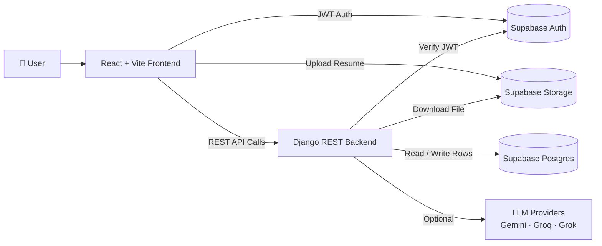

<div align="center">

# 🚀 CareerForge AI — Resume Analyzer

### AI-powered resume analysis, ATS scoring, job tracking & mock interviews


</div>

---

## 📑 Table of Contents

- [Overview](#-overview)
- [Key Features](#-key-features)
- [Tech Stack](#-tech-stack)
- [System Architecture](#-system-architecture)
- [Project Structure](#-project-structure)
- [How It Works](#-how-it-works)
- [API Reference](#-api-reference)
- [Getting Started](#-getting-started)
- [Environment Variables](#-environment-variables)
- [Database Schema](#-database-schema)
- [AI Provider Configuration](#-ai-provider-configuration)
- [Troubleshooting](#-troubleshooting)
- [Deployment](#-deployment)
- [Author](#-author)

---

## 📌 Overview

**CareerForge AI** is a full-stack web application that processes, evaluates, and improves professional resumes using a combination of **deterministic scoring algorithms** and **Large Language Models (LLMs)**.

Upload a resume, target a job, and get:

- 📊 A **job-targeted resume analysis** (scores, skill gaps, quick wins, salary range, cover letter drafts)
- 🎤 A **personalized mock interview** generated from your own resume
- 🧠 An **interview evaluation** with scores, strengths, and areas to improve

---

## ✨ Key Features

| Feature | Description |
|---|---|
| 📄 **Precision Document Parsing** | Extracts structured data from PDF and DOCX files and maps raw text to clean data models. |
| 🎯 **Deterministic ATS Scoring** | Math-based rubric for compatibility, keyword density, and gap analysis, with no AI hallucinations. |
| 🤖 **AI-Powered Optimization** | Uses multiple LLM providers (Gemini, Groq, Grok) to rewrite bullet points and strengthen action verbs. |
| 📤 **Multi-Format Export** | Compiles optimized resumes back into production-ready PDF and DOCX files. |
| 📋 **Kanban Job Tracker** | Manage applications across Wishlist, Applied, Interviewing, and Offered. |
| 🎙️ **Mock AI Interviewer** | Practice interviews tailored to your resume (technical, behavioral, system design). |
| ✉️ **Cover Letter Drafts** | Generates professional, conversational, and creative tones. |
| 🔐 **Secure Auth & Storage** | Supabase Auth with JWT verification, Row Level Security, and private file storage. |

---

## 🛠️ Tech Stack

### Frontend
- **Framework:** React 18 + Vite
- **Routing:** TanStack Router / Server Functions
- **Styling:** Tailwind CSS + Framer Motion
- **Icons:** Lucide React
- **Validation:** Zod

### Backend
- **Framework:** Django + Django REST Framework
- **Parsing:** `pypdf`, `python-docx`
- **ML / Scoring:** scikit-learn (TF-IDF + cosine similarity)
- **AI Providers:** Google Gemini, Groq, xAI Grok

### Data & Infrastructure
- **Database:** Supabase (PostgreSQL + Row Level Security)
- **Auth:** Supabase Auth (JWT)
- **Storage:** Supabase Storage

---

## 🏗️ System Architecture



---

## 📂 Project Structure

```text
Resume_Analyzer/
├── backend/                     # Django REST API + scoring logic
│   ├── api/
│   │   ├── views.py             # API endpoints
│   │   ├── urls.py              # Route mapping
│   │   └── services.py          # Parsing, scoring & interview logic
│   ├── config/                  # Django settings, wsgi/asgi
│   ├── scripts/
│   │   └── test_api.py          # Quick local integration test
│   ├── manage.py
│   └── requirements.txt
│
├── frontend/                    # Browser UI
│   └── src/
│       ├── serverFns/           # Server functions calling backend endpoints
│       └── lib/
│           └── backend.ts       # fetch wrapper: backendPost()
│
├── docs/
├── Resume_Analyzer_Proposal_short.md
└── README.md
```

---

## 🔄 How It Works

### 1️⃣ Authentication
The frontend gets a user JWT from **Supabase Auth**. Every backend call includes `accessToken`, and the backend verifies it against Supabase `/auth/v1/user` before touching any data.

### 2️⃣ Resume Upload
The resume is uploaded to **Supabase Storage**. A row is created in the `resumes` table with a `file_path` pointing to the stored object.

### 3️⃣ Resume Parsing — `POST /api/resumes/parse/`
The backend downloads the file and extracts text (PDF via `pypdf`, DOCX via `python-docx`, otherwise UTF-8 fallback). It then computes:

- `extracted_skills`: regex match against a large `COMMON_SKILLS` list
- `total_experience_years`: from "X years" patterns or graduation years
- `education_level`: PhD, Master's, Bachelor's, etc.
- `word_count`
- `is_ats_friendly`: contact info + section keywords + reasonable length

### 4️⃣ Job-Targeted Analysis — `POST /api/analyses/create/`
Generates ATS, skills, experience, education, and culture-fit scores, plus interview probability, letter grade, matched and missing keywords, skill gaps, a learning roadmap, quick wins, a salary range, and cover letter drafts.

### 5️⃣ Mock Interview — `start → evaluate → finish`
- **Start:** builds N questions (technical / behavioral / system design) from your skills
- **Evaluate:** scores each answer on relevance, completeness, communication, and depth using TF-IDF cosine similarity and structure heuristics (STAR-style)
- **Finish:** returns an overall score, grade, performance breakdown, strengths, and improvements

---

## 📡 API Reference

**Base path:** `/api/` · All endpoints accept **JSON** bodies.

| Method | Endpoint | Description |
|:---:|---|---|
| `GET` | `/api/health/` | Health check |
| `POST` | `/api/resumes/parse/` | Parse an uploaded resume |
| `POST` | `/api/resumes/delete/` | Delete a resume |
| `POST` | `/api/resumes/set-primary/` | Set the primary resume |
| `POST` | `/api/analyses/create/` | Create a job-targeted analysis |
| `POST` | `/api/analyses/delete/` | Delete an analysis |
| `POST` | `/api/interview/start/` | Start an interview session |
| `POST` | `/api/interview/evaluate/` | Evaluate a single answer |
| `POST` | `/api/interview/finish/` | Finish and summarize the interview |
| `POST` | `/api/interview/delete/` | Delete an interview session |

<details>
<summary><b>📥 Example Request Bodies (click to expand)</b></summary>

#### Parse Resume
```json
{
  "accessToken": "<user_jwt>",
  "resumeId": "<uuid>"
}
```

#### Create Analysis
```json
{
  "accessToken": "<user_jwt>",
  "resumeId": "<uuid>",
  "jobTitle": "...",
  "companyName": "...",
  "location": "...",
  "companyDescription": "...",
  "jobDescription": "..."
}
```

#### Start Interview
```json
{
  "accessToken": "<user_jwt>",
  "resumeId": "<uuid>",
  "difficulty": "medium",
  "mode": "text",
  "totalQuestions": 10
}
```

#### Evaluate Answer
```json
{
  "accessToken": "<user_jwt>",
  "sessionId": "<uuid>",
  "questionId": 1,
  "questionText": "...",
  "questionCategory": "technical",
  "questionDifficulty": "medium",
  "userAnswer": "...",
  "language": "en"
}
```

#### Finish Interview
```json
{
  "accessToken": "<user_jwt>",
  "sessionId": "<uuid>"
}
```

</details>

---

## 🚀 Getting Started

### Prerequisites

- **Node.js** 18+ (or Bun)
- **Python** 3.10+
- A **Supabase project** (Auth + Postgres + Storage)

### 1. Clone the repository

```bash
git clone https://github.com/abuhuraira5130/Resume_Analyzer.git
cd Resume_Analyzer
```

### 2. Run the Backend (Django)

```bash
cd backend

# Create and activate a virtual environment
python -m venv venv
.\venv\Scripts\activate      # Windows
source venv/bin/activate     # Mac / Linux

# Install dependencies
pip install -r requirements.txt

# Start the server
python manage.py runserver 8000
```

### 3. Run the Frontend (React + Vite)

```bash
cd frontend
npm install
npm run dev
```

Open the local URL printed in your terminal (for example `http://localhost:8080` or `http://localhost:5173`).

---

## 🔐 Environment Variables

### Frontend — `frontend/.env`

| Variable | Description |
|---|---|
| `VITE_BACKEND_URL` | Backend URL (e.g. `http://localhost:8000`) |
| `VITE_SUPABASE_URL` | Your Supabase project URL |
| `VITE_SUPABASE_ANON_KEY` | Supabase anon public key |

### Backend — `backend/.env`

| Variable | Required | Description |
|---|:---:|---|
| `DATABASE_URL` | ✅ | Supabase Postgres connection string (include `sslmode=require`) |
| `SUPABASE_URL` | ✅ | Supabase project URL |
| `SUPABASE_ANON_KEY` | ✅ | Supabase anon key |
| `SUPABASE_SERVICE_ROLE_KEY` | ✅ | Supabase service role key (**keep secret**) |
| `CORS_ALLOWED_ORIGINS` | ➖ | Comma-separated allowed origins |

> ⚠️ **Never commit `.env` files or your service role key to GitHub.**

---

## 🗄️ Database Schema

The backend uses these Supabase tables (inferred from the code):

<details>
<summary><b>📁 resumes</b></summary>

`id`, `user_id`, `title`, `file_path`, `parse_status`, `parse_error`, `raw_text`, `extracted_skills`, `total_experience_years`, `education_level`, `word_count`, `is_ats_friendly`, `is_primary`

</details>

<details>
<summary><b>📁 analyses</b></summary>

`id`, `user_id`, `resume_id`, `status`, `error_message`, `job_title`, `company_name`, `location`, `job_description`, `company_description`, plus all scoring output fields from `generate_analysis`

</details>

<details>
<summary><b>📁 interview_sessions</b></summary>

`id`, `user_id`, `resume_id`, `difficulty`, `mode`, `language`, `status`, `total_questions`, `questions`, `answers`, `overall_score`, `grade`, `performance_breakdown`, `scores`, `strengths`, `improvements`

</details>

> If your schema differs, align the table and column names with the backend code.

---

## 🧠 AI Provider Configuration

The system is modular. Users can securely add their own API keys from the **Profile Settings** page in the frontend.

| Provider | Example Models |
|---|---|
| **Google Gemini** | `gemini-1.5-flash`, `gemini-2.5-flash` |
| **Groq** | `llama3-70b-8192`, `mixtral-8x7b-32768` |
| **xAI Grok** | Grok models |

> 💡 Default fallbacks exist for quick onboarding, but per-user API keys are recommended for production.

---

## 🩺 Troubleshooting

<details>
<summary><b>Backend fails with a <code>DATABASE_URL</code> error</b></summary>

`config/settings.py` requires `DATABASE_URL`. Use your Supabase Postgres connection string and make sure it includes `sslmode=require`.

</details>

<details>
<summary><b>CORS errors in the browser</b></summary>

Add your frontend origin (e.g. `http://localhost:5173` or `http://localhost:8080`) to `CORS_ALLOWED_ORIGINS` in `backend/.env`.

</details>

<details>
<summary><b>"Resume isn't parsed yet"</b></summary>

Call order matters:
1. `POST /api/resumes/parse/`
2. `POST /api/analyses/create/`
3. `POST /api/interview/start/`

</details>

<details>
<summary><b>Storage permission failures</b></summary>

- Make sure the Supabase Storage bucket allows authenticated users to access their own resume files.
- Check that `resumes.file_path` values are correct.

</details>

---

## 🌍 Deployment

| Part | Suggested Platform |
|---|---|
| **Frontend** | Vercel / Netlify (Vite build) |
| **Backend** | Render / Railway / Heroku / Docker |
| **Database, Auth & Storage** | Supabase |

Before deploying, set all environment variables and review your Supabase **Row Level Security** policies.

---

## 👨‍💻 Author

**Abu Huraira**
BSAI Student · Full-Stack & AI Developer

[](https://github.com/abuhuraira5130)

---

<div align="center">

⭐ If you like this project, give it a star!

</div>
