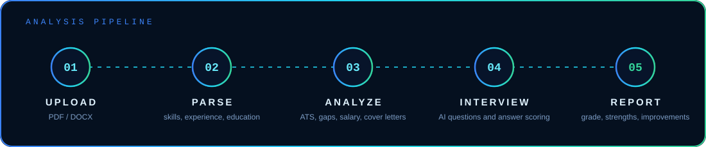
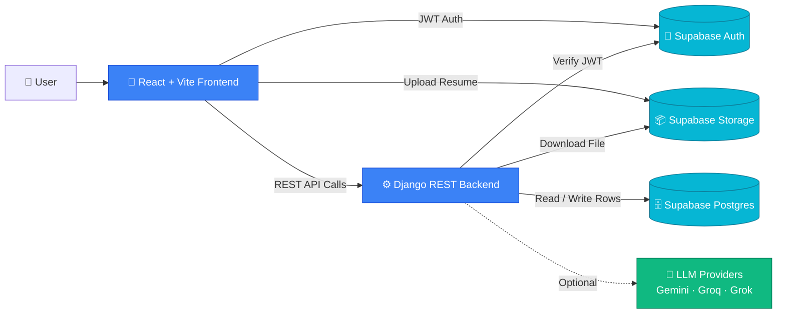

<div align="center">



<br/>

[](#-getting-started)
[](#️-deployment)
[](#-author)


<br/>

<a href="#-key-features"><b>✨ Features</b></a>
&nbsp;•&nbsp;
<a href="#-how-it-works"><b>⚙️ How It Works</b></a>
&nbsp;•&nbsp;
<a href="#-api-reference"><b>📡 API</b></a>
&nbsp;•&nbsp;
<a href="#-getting-started"><b>🚀 Get Started</b></a>

</div>


## 📑 Table of Contents

- [📌 Overview](#-overview)
- [📸 Preview](#-preview)
- [✨ Key Features](#-key-features)
- [📊 What Gets Scored](#-what-gets-scored)
- [⚙️ How It Works](#️-how-it-works)
- [🛠️ Tech Stack](#️-tech-stack)
- [🏗️ System Architecture](#️-system-architecture)
- [📂 Project Structure](#-project-structure)
- [📡 API Reference](#-api-reference)
- [🚀 Getting Started](#-getting-started)
- [🔐 Environment Variables](#-environment-variables)
- [🗄️ Database Schema](#️-database-schema)
- [🧠 AI Provider Configuration](#-ai-provider-configuration)
- [🩺 Troubleshooting](#-troubleshooting)
- [☁️ Deployment](#️-deployment)
- [👨‍💻 Author](#-author)


## 📌 Overview

**CareerForge AI** is a full-stack web application that processes, evaluates, and improves professional resumes using a combination of **deterministic scoring algorithms** and **Large Language Models (LLMs)**.

Upload a resume, target a job, and get:

| 📊 **Job-targeted analysis** | 🎤 **Mock interview** | 🧠 **Interview evaluation** |
|:---:|:---:|:---:|
| Scores, skill gaps, quick wins, salary range and cover letter drafts | Questions generated from your own resume and skills | Scores, strengths and improvement tips for every answer |

> 🚧 **Project status:** CareerForge AI currently runs locally and is not deployed yet. Follow [Getting Started](#-getting-started) to run it on your machine, or see [Deployment](#️-deployment) for the hosting plan.

---

## 📸 Preview

<div align="center">


<br/><br/>

| 📊 Analysis Result | 🎤 Mock Interview | 📋 Job Tracker |
|:---:|:---:|:---:|
|  |  |  |

</div>

---


## ✨ Key Features

| | Feature | Description |
|:---:|---|---|
| 📄 | **Precision document parsing** | Extracts structured data from PDF and DOCX files and maps raw text to clean data models. |
| 🎯 | **Deterministic ATS scoring** | A math-based rubric for compatibility, keyword density, and gap analysis, with no AI hallucinations. |
| 🤖 | **AI-powered optimization** | Uses multiple LLM providers (Gemini, Groq, Grok) to rewrite bullet points and strengthen action verbs. |
| 📤 | **Multi-format export** | Compiles optimized resumes back into production-ready PDF and DOCX files. |
| 📋 | **Kanban job tracker** | Manage applications across Wishlist, Applied, Interviewing, and Offered. |
| 🎙️ | **Mock AI interviewer** | Practice technical, behavioral, and system design interviews tailored to your resume. |
| ✉️ | **Cover letter drafts** | Generates professional, conversational, and creative tones. |
| 🔐 | **Secure auth & storage** | Supabase Auth with JWT verification, Row Level Security, and private file storage. |

---

## 📊 What Gets Scored

Every analysis produces these signals:

| Signal | What it measures |
|---|---|
| 🎯 **ATS score** | Keyword match and resume structure against the target job |
| ⚙️ **Skills score** | How many of the job's required skills your resume covers |
| 💼 **Experience score** | Your experience level against what the role expects |
| 🎓 **Education score** | Your education level against the role |
| 🤝 **Culture-fit score** | How well your profile reads for the company |
| 📈 **Interview probability & grade** | A combined signal turned into a letter grade |

Along with the scores, you get matched and missing keywords, skill gaps (critical or important), a learning roadmap, quick wins, a salary range, and cover letter drafts.

---


## ⚙️ How It Works

<div align="center">



</div>

<details open>
<summary><b>1️⃣ Authentication</b></summary>
<br/>

The frontend gets a user JWT from **Supabase Auth**. Every backend call includes `accessToken`, and the backend verifies it against Supabase `/auth/v1/user` before touching any data.

</details>

<details open>
<summary><b>2️⃣ Resume upload</b></summary>
<br/>

The resume is uploaded to **Supabase Storage**, and a row is created in the `resumes` table with a `file_path` pointing to the stored file.

</details>

<details open>
<summary><b>3️⃣ Resume parsing — <code>POST /api/resumes/parse/</code></b></summary>
<br/>

The backend downloads the file and extracts text (PDF via `pypdf`, DOCX via `python-docx`, otherwise UTF-8 fallback). It then computes:

- `extracted_skills`: regex match against a large `COMMON_SKILLS` list
- `total_experience_years`: from "X years" patterns or graduation years
- `education_level`: PhD, Master's, Bachelor's, etc.
- `word_count` and `is_ats_friendly`: contact info, section keywords, and reasonable length

</details>

<details open>
<summary><b>4️⃣ Job-targeted analysis — <code>POST /api/analyses/create/</code></b></summary>
<br/>

Generates the ATS, skills, experience, education, and culture-fit scores, plus interview probability, letter grade, matched and missing keywords, skill gaps, a learning roadmap, quick wins, a salary range, and cover letter drafts.

</details>

<details open>
<summary><b>5️⃣ Mock interview — start → evaluate → finish</b></summary>
<br/>

- **Start:** builds N questions (technical / behavioral / system design) from your skills
- **Evaluate:** scores each answer on relevance, completeness, communication, and depth using TF-IDF cosine similarity and STAR-style structure heuristics
- **Finish:** returns an overall score, grade, performance breakdown, strengths, and improvements

</details>

---


## 🛠️ Tech Stack

<div align="center">


</div>

| Layer | Technologies |
|:---:|---|
| 🎨 **Frontend** | React 18, Vite, TanStack Router / Server Functions, Tailwind CSS, Framer Motion, Lucide React, Zod |
| ⚙️ **Backend** | Django, Django REST Framework, `pypdf`, `python-docx` |
| 🧪 **ML / Scoring** | scikit-learn (TF-IDF + cosine similarity) |
| 🤖 **AI providers** | Google Gemini, Groq, xAI Grok |
| 🗄️ **Data & infra** | Supabase (PostgreSQL, Auth, Storage, Row Level Security) |

---

## 🏗️ System Architecture



---


## 📂 Project Structure

```text
Resume_Analyzer_And-_Enhancer/
├── backend/                     # Django REST API + scoring logic
│   ├── api/
│   │   ├── views.py             # API endpoints
│   │   ├── urls.py              # Route mapping
│   │   └── services.py          # Parsing, scoring & interview logic
│   ├── config/                  # Django settings, wsgi/asgi
│   ├── scripts/
│   │   └── test_api.py          # Quick local integration test
│   ├── manage.py
│   └── requirements.txt
│
├── frontend/                    # Browser UI
│   └── src/
│       ├── serverFns/           # Server functions calling backend endpoints
│       └── lib/
│           └── backend.ts       # fetch wrapper: backendPost()
│
├── assets/                      # Animated README graphics (SVG)
├── docs/
│   └── screenshots/             # README images
├── Resume_Analyzer_Proposal_short.md
└── README.md
```

---


## 📡 API Reference

**Base path:** `/api/` · All endpoints accept **JSON** bodies.

| Method | Endpoint | Description |
|:---:|---|---|
| `GET` | `/api/health/` | Health check |
| `POST` | `/api/resumes/parse/` | Parse an uploaded resume |
| `POST` | `/api/resumes/delete/` | Delete a resume |
| `POST` | `/api/resumes/set-primary/` | Set the primary resume |
| `POST` | `/api/analyses/create/` | Create a job-targeted analysis |
| `POST` | `/api/analyses/delete/` | Delete an analysis |
| `POST` | `/api/interview/start/` | Start an interview session |
| `POST` | `/api/interview/evaluate/` | Evaluate a single answer |
| `POST` | `/api/interview/finish/` | Finish and summarize the interview |
| `POST` | `/api/interview/delete/` | Delete an interview session |

<details>
<summary><b>📥 Example request bodies (click to expand)</b></summary>

#### Parse Resume
```json
{
  "accessToken": "<user_jwt>",
  "resumeId": "<uuid>"
}
```

#### Create Analysis
```json
{
  "accessToken": "<user_jwt>",
  "resumeId": "<uuid>",
  "jobTitle": "...",
  "companyName": "...",
  "location": "...",
  "companyDescription": "...",
  "jobDescription": "..."
}
```

#### Start Interview
```json
{
  "accessToken": "<user_jwt>",
  "resumeId": "<uuid>",
  "difficulty": "medium",
  "mode": "text",
  "totalQuestions": 10
}
```

#### Evaluate Answer
```json
{
  "accessToken": "<user_jwt>",
  "sessionId": "<uuid>",
  "questionId": 1,
  "questionText": "...",
  "questionCategory": "technical",
  "questionDifficulty": "medium",
  "userAnswer": "...",
  "language": "en"
}
```

#### Finish Interview
```json
{
  "accessToken": "<user_jwt>",
  "sessionId": "<uuid>"
}
```

</details>

---


## 🚀 Getting Started

### Prerequisites

- **Node.js** 18+ (or Bun)
- **Python** 3.10+
- A **Supabase project** (Auth + Postgres + Storage)

### 1️⃣ Clone the repository

```bash
git clone https://github.com/abuhuraira5130/Resume_Analyzer_And-_Enhancer.git
cd Resume_Analyzer_And-_Enhancer
```

### 2️⃣ Run the backend (Django)

```bash
cd backend

# Create and activate a virtual environment
python -m venv venv
.\venv\Scripts\activate      # Windows
source venv/bin/activate     # Mac / Linux

# Install dependencies
pip install -r requirements.txt

# Start the server
python manage.py runserver 8000
```

### 3️⃣ Run the frontend (React + Vite)

```bash
cd frontend
npm install
npm run dev
```

Open the local URL printed in your terminal (for example `http://localhost:8080` or `http://localhost:5173`).

---

## 🔐 Environment Variables

### Frontend: `frontend/.env`

| Variable | Description |
|---|---|
| `VITE_BACKEND_URL` | Backend URL (e.g. `http://localhost:8000`) |
| `VITE_SUPABASE_URL` | Your Supabase project URL |
| `VITE_SUPABASE_ANON_KEY` | Supabase anon public key |

### Backend: `backend/.env`

| Variable | Required | Description |
|---|:---:|---|
| `DATABASE_URL` | ✅ | Supabase Postgres connection string (include `sslmode=require`) |
| `SUPABASE_URL` | ✅ | Supabase project URL |
| `SUPABASE_ANON_KEY` | ✅ | Supabase anon key |
| `SUPABASE_SERVICE_ROLE_KEY` | ✅ | Supabase service role key (**keep secret**) |
| `CORS_ALLOWED_ORIGINS` | ➖ | Comma-separated allowed origins |

> ⚠️ **Never commit `.env` files, API keys or your service role key to GitHub.**

---


## 🗄️ Database Schema

The backend uses these Supabase tables (inferred from the code):

<details>
<summary><b>📁 resumes</b></summary>

`id`, `user_id`, `title`, `file_path`, `parse_status`, `parse_error`, `raw_text`, `extracted_skills`, `total_experience_years`, `education_level`, `word_count`, `is_ats_friendly`, `is_primary`

</details>

<details>
<summary><b>📁 analyses</b></summary>

`id`, `user_id`, `resume_id`, `status`, `error_message`, `job_title`, `company_name`, `location`, `job_description`, `company_description`, plus all scoring output fields from `generate_analysis`

</details>

<details>
<summary><b>📁 interview_sessions</b></summary>

`id`, `user_id`, `resume_id`, `difficulty`, `mode`, `language`, `status`, `total_questions`, `questions`, `answers`, `overall_score`, `grade`, `performance_breakdown`, `scores`, `strengths`, `improvements`

</details>

> If your schema differs, align the table and column names with the backend code.

---

## 🧠 AI Provider Configuration

The system is modular. Users can add their own API keys from the **Profile Settings** page in the frontend.

| Provider | Example models |
|---|---|
| 🟣 **Google Gemini** | `gemini-1.5-flash`, `gemini-2.5-flash` |
| 🟠 **Groq** | `llama3-70b-8192`, `mixtral-8x7b-32768` |
| ⚫ **xAI Grok** | Grok models |

> 💡 Per-user API keys are recommended for production.

---

## 🩺 Troubleshooting

<details>
<summary><b>Backend fails with a <code>DATABASE_URL</code> error</b></summary>

`config/settings.py` requires `DATABASE_URL`. Use your Supabase Postgres connection string and make sure it includes `sslmode=require`.

</details>

<details>
<summary><b>CORS errors in the browser</b></summary>

Add your frontend origin (e.g. `http://localhost:5173` or `http://localhost:8080`) to `CORS_ALLOWED_ORIGINS` in `backend/.env`.

</details>

<details>
<summary><b>"Resume isn't parsed yet"</b></summary>

Call order matters: `parse` → `analyses/create` → `interview/start`.

</details>

<details>
<summary><b>Storage permission failures</b></summary>

Make sure the Supabase Storage bucket allows authenticated users to access their own resume files, and that `resumes.file_path` values are correct.

</details>

---


## ☁️ Deployment

CareerForge AI is not deployed yet. The planned hosting setup:

| Part | Platform |
|---|---|
| 🎨 **Frontend** | Vercel / Netlify (Vite build) |
| ⚙️ **Backend** | Render / Railway / Docker |
| 🗄️ **Database, Auth & Storage** | Supabase |

Before deploying, set all environment variables and review your Supabase **Row Level Security** policies.

- [x] Resume parsing, ATS scoring and mock interviews
- [x] Supabase auth, storage and database integration
- [ ] Public live demo

---


## 👨‍💻 Author

<div align="center">

### **Abu Huraira**
*Full Stack Developer · AI/ML Engineer · BS AI Student*

[](https://github.com/abuhuraira5130)
[](https://huraira-labs.vercel.app/)

<br/>

⭐ **If CareerForge AI helps you, give it a star!** ⭐


</div>
